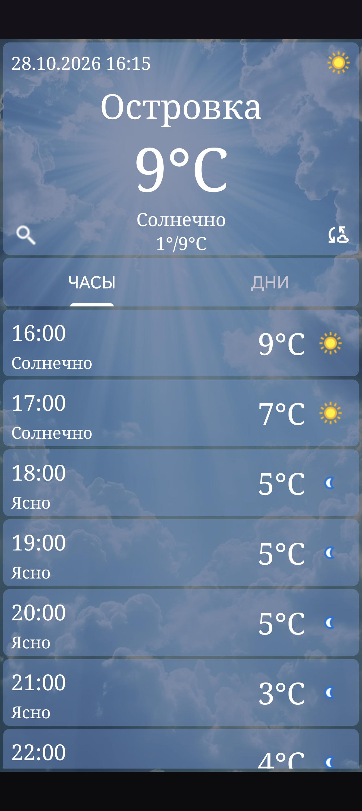
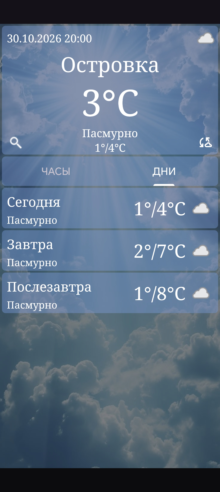

# 🌦 WeatherApp

Android-приложение для отображения текущей погоды и прогноза по дням/часам, написанное на Kotlin с применением Clean Architecture и MVI.

## ✨ Возможности

- 📍 Определение текущего местоположения через FusedLocationProvider (с поддержкой точной и приблизительной геолокации на Android 12+)
- 🔍 Поиск погоды по названию города
- 🌡 Текущая погода: температура, состояние, иконка, min/max
- 📅 Прогноз на 3 дня (сегодня и 2 последующих)
- 🕐 Почасовой прогноз (ближайшие 24 часа или выбранный день)
- 💾 Локальное кэширование через Room (работает офлайн)
- 🔄 Кастомный Swipe-to-Refresh для обновления карточки
- 🌐 Локализация интерфейса и данных (через параметр API `lang=ru`)

## 🛠 Технологический стек

**Язык и асинхронность**
- Kotlin
- Coroutines + Flow (StateFlow, SharedFlow, Channel)
- ViewModel, Lifecycle, repeatOnLifecycle

**Архитектура**
- Clean Architecture (data / domain / presentation)
- MVI (Model-View-Intent) с одноразовыми эффектами
- Repository pattern + Single Source of Truth (SSOT)

**Сеть**
- Retrofit 2
- OkHttp 3 + HttpLoggingInterceptor
- Gson + @SerializedName

**Локальное хранилище**
- Room (SQLite)
- Composite Primary Keys
- ForeignKey с CASCADE
- @Relation (одним запросом собирает current + forecast + hours)
- @Transaction для атомарного обновления

**DI**
- Hilt (Dagger Hilt) с использованием `@ActivityRetainedScoped` для холдеров

**UI**
- ViewBinding
- Material Design Components
- RecyclerView + ListAdapter
- ViewPager2 + TabLayout
- Picasso

**Тестирование**
- JUnit, MockK, kotlinx-coroutines-test (21 Unit-тест)

## 🧱 Архитектура

Проект разделён на три слоя с чёткими границами:
`presentation → domain ← data`

### 📦 data
- **remote** — Retrofit API (`WeatherApi`), обёртка `WeatherRemoteDataSource`
- **models (DTO)** — `WeatherResponseDTO`, `LocationDTO`, `CurrentDTO`, `ConditionDTO`, `ForecastDTO`, `ForecastDayDTO`, `DayDTO`, `HourDTO`
- **mappers** — `DtoToEntityMapper` (DTO → Entity), `EntityToDomainMapper` (Entity → Domain)
- **room** — `CurrentWeatherEntity`, `ForecastDayEntity`, `HourlyWeatherEntity`, `WeatherWithDetails` (@Relation), `WeatherDao`, `WeatherDataBase`
- **repository** — `WeatherRepositoryImpl`
- **location** — `FusedLocationTracker` (реализация получения GPS)

### 📦 domain
- **models** — `CurrentWeather`, `DailyForecast`, `HourlyForecast` (типизированные данные с `Double` и `LocalDate`)
- **repository** — интерфейс `WeatherRepository`
- **location** — интерфейс `LocationTracker` и `LocationResult` (sealed class)
- **useCases** — `GetCurrentWeatherUseCase`, `GetForecastWeatherUseCase`, `GetHoursForDayUseCase`, `RefreshWeatherUseCase`

### 📦 presentation
- **fragments** — `main`, `days`, `hours` (каждый со своим ViewModel, UiState, UiEvent)
- **holders** — `CityHolder`, `SelectedDayHolder` (`@ActivityRetainedScoped` для связи между ViewModel)
- **adapters** — `RecyclerWeatherAdapter`
- **mappers** — `WeatherUiMapper` (форматирование Domain → UI)

## 🔄 Поток данных (SSOT)
Retrofit → DTO → Entities → Room → Flow → Domain → ViewModel → UI

text

**Retrofit пишет в Room. Всё остальное читается только из Room.** Это даёт:
- работу офлайн
- единый источник правды
- реактивное обновление UI при изменении БД

## 🎯 Что реализовано

- ✅ Переход с Volley на Retrofit + OkHttp
- ✅ Замена LiveData и EventBus на StateFlow и Channel
- ✅ Переход с MVVM на MVI (одноразовые эффекты через Channel)
- ✅ Кэширование через Room с нормализацией (3 таблицы)
- ✅ SSOT: single source of truth через Room
- ✅ Hilt для внедрения зависимостей (холдеры на `@ActivityRetainedScoped`)
- ✅ Абстракция геолокации (LocationTracker + suspendCancellableCoroutine)
- ✅ Вынос бизнес-логики фильтрации часов в Domain (с учетом часовых поясов)
- ✅ Полная локализация (lang=ru, strings.xml, отсутствие Context в ViewModel)
- ✅ Кастомный Swipe-to-Refresh (без ломки верстки)
- ✅ 21 Unit-тест на ViewModel, репозиторий и мапперы (mockk + StandardTestDispatcher)

## 📸 Скриншоты

<p align="center">
  
  
</p>

## 🚀 Как запустить

**1. Клонировать репозиторий:**
```bash
git clone https://github.com/Kirill2502/WeatherApp.git
2. Получить API-ключ:
Зарегистрируйтесь на weatherapi.com и получите бесплатный API-ключ.

3. Настроить local.properties:
Создайте файл local.properties в корне проекта и добавьте туда ваш ключ:

properties
WEATHER_API_KEY=твой_ключ
4. Запустить проект:
Откройте проект в Android Studio, дождитесь окончания синхронизации Gradle и запустите приложение на эмуляторе или реальном устройстве (минимальная версия Android — 7.0 / API 24).
